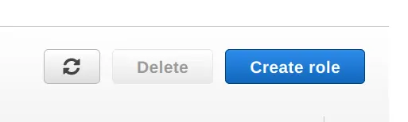
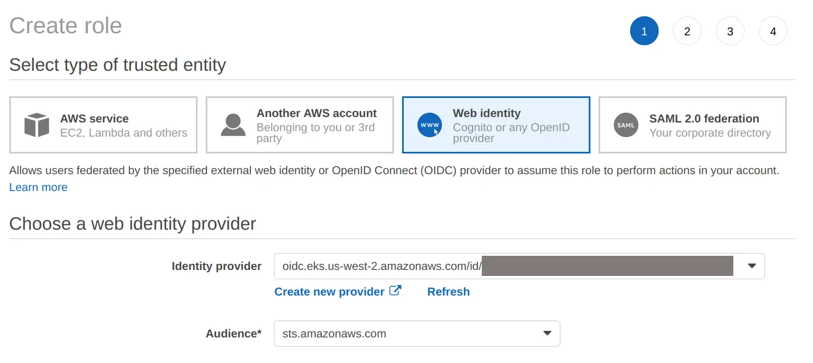

# Saturn Users and IAM Roles

{}
This article describes AWS-specific configuration using AWS IAM and EKS IRSA. If you are installing Saturn Cloud on other cloud providers, see the [Getting Started guide](/docs) or contact us at <a href="mailto:support@saturncloud.io">support@saturncloud.io</a> for equivalent guidance.
{}

Saturn Cloud allows administrators to grant access to IAM roles to Saturn users. When a user has an IAM role, their resources will be run as that IAM role, granting their resources the permission to connect to other AWS components that the role has permissions for. This can be very useful in limiting who can access items like S3 buckets.

## Requirements

The Saturn Cloud infrastructure is built on top of AWS EKS. Associating IAM roles with Saturn users leverages EKS mechanisms for mapping [IAM roles to pods via service accounts](https://docs.aws.amazon.com/eks/latest/userguide/iam-roles-for-service-accounts.html). In order to do this, you must contact support@saturncloud.io in order to enable IRSA for your EKS cluster.

## How Saturn Cloud uses an IAM role

In Saturn Cloud, an administrator creates a **service account**: a name plus the ARN of one IAM role. Saturn Cloud creates a Kubernetes service account with that name in the `main-namespace` namespace and annotates it with the role ARN. Administrators then grant the service account to users and groups. When a user attaches it to a workspace, job, deployment or Dask cluster, those pods run as that Kubernetes service account, and EKS gives them credentials for the IAM role.

The IAM role's trust policy decides which pods may assume it. It must name the Kubernetes service account, not only the audience. A trust policy that checks only the audience (`:aud`) lets any pod in the cluster assume the role, because any pod can be given a token with that audience. That includes pods that belong to users who were never granted the role.

For a Saturn Cloud service account named `<name>`, the subject (`:sub`) that the trust policy must check is:

```
system:serviceaccount:main-namespace:<name>
```

The namespace is always `main-namespace`, for workspaces, jobs, deployments and Dask clusters. The name is exactly what you type in the **Name** field when you create the service account in Saturn Cloud, and it cannot be changed afterwards. So choose the name first, then create the IAM role. Names must be lowercase letters, numbers, `-` or `.`, and start and end with a letter or number.

## Creating Roles

First, navigate to the [IAM role page in the AWS console](https://console.aws.amazon.com/iamv2/home?#/roles). Click on "Create Role"



Next, select "Web Identity", and choose the OIDC provider for your EKS cluster. Choose `sts.amazonaws.com` as the audience.



The console only adds the audience condition. Continue with role creation and permissions as you would for any other IAM role. Then, before you use the role, open the role's **Trust relationships** tab, click **Edit trust policy**, and add the `:sub` condition so that the policy matches the example below.

The trust policy should match this pattern. In this example, the Saturn Cloud service account is named `data-science`:

```
{
  "Version": "2012-10-17",
  "Statement": [
    {
      "Effect": "Allow",
      "Principal": {
        "Federated": "arn:aws:iam::111122223333:oidc-provider/oidc.eks.us-west-2.amazonaws.com/id/EXAMPLED539D4633E53DE1B71EXAMPLE"
      },
      "Action": "sts:AssumeRoleWithWebIdentity",
      "Condition": {
        "StringEquals": {
          "oidc.eks.us-west-2.amazonaws.com/id/EXAMPLED539D4633E53DE1B71EXAMPLE:aud": "sts.amazonaws.com",
          "oidc.eks.us-west-2.amazonaws.com/id/EXAMPLED539D4633E53DE1B71EXAMPLE:sub": "system:serviceaccount:main-namespace:data-science"
        }
      }
    }
  ]
}
```

Replace the following:

- The account ID and the provider ID in `Federated` with the ARN of your cluster's OIDC provider. You can find the issuer with `aws eks describe-cluster --name <cluster-name> --query "cluster.identity.oidc.issuer" --output text`; the condition keys use the issuer without `https://`.
- `data-science` with the name of your Saturn Cloud service account.

Put the `:aud` and `:sub` keys in the **same** `StringEquals` block, as shown. Don't write two `StringEquals` keys in the same `Condition`. A JSON object can't hold the same key twice, so most tools, including Terraform's `jsonencode`, keep only one of the two blocks, and the policy silently loses a check.

No wildcard is needed. Use `StringEquals` with the exact subject, not `StringLike`.

### Using one IAM role for several users or groups

You don't need to change the trust policy to share a role. Create one Saturn Cloud service account for the role and grant that service account to every user and group that should use it. The trust policy then names that one service account.

If you have created more than one Saturn Cloud service account that uses the same IAM role, list each subject in an array. AWS allows a match on any value in the list:

```
"StringEquals": {
  "oidc.eks.us-west-2.amazonaws.com/id/EXAMPLED539D4633E53DE1B71EXAMPLE:aud": "sts.amazonaws.com",
  "oidc.eks.us-west-2.amazonaws.com/id/EXAMPLED539D4633E53DE1B71EXAMPLE:sub": [
    "system:serviceaccount:main-namespace:data-science",
    "system:serviceaccount:main-namespace:analytics"
  ]
}
```

### If you created roles from earlier versions of this page

Earlier versions of this page showed a trust policy with only the `:aud` condition. If you created a role that way, add the `:sub` condition as described above. To see a role's current trust policy, run:

```
aws iam get-role --role-name <role-name> --query Role.AssumeRolePolicyDocument
```

If the `Condition` has an `:aud` key but no `:sub` key, update the policy with **Edit trust policy** in the console, or with `aws iam update-assume-role-policy --role-name <role-name> --policy-document file://trust-policy.json`. Running resources pick up the change on their next request for credentials; you don't need to restart them.

## Attaching roles

After the role is created, an administrator connects it to Saturn Cloud:

1. Go to **Account**, open the **Service Accounts** tab, and create a service account. Enter the **Name** that the role's trust policy uses, and the role ARN in **IAM Role Arn**.
2. Open the user or group, go to its **Service Accounts** tab, and click **Associate a Service Account**.

You can grant users and groups several service accounts. If a user or group has access to only one, it is attached to their resources automatically. Otherwise, they choose which one to attach to each resource.

{}
