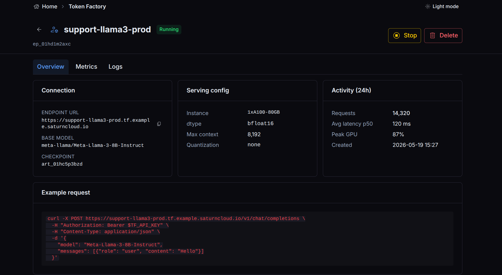
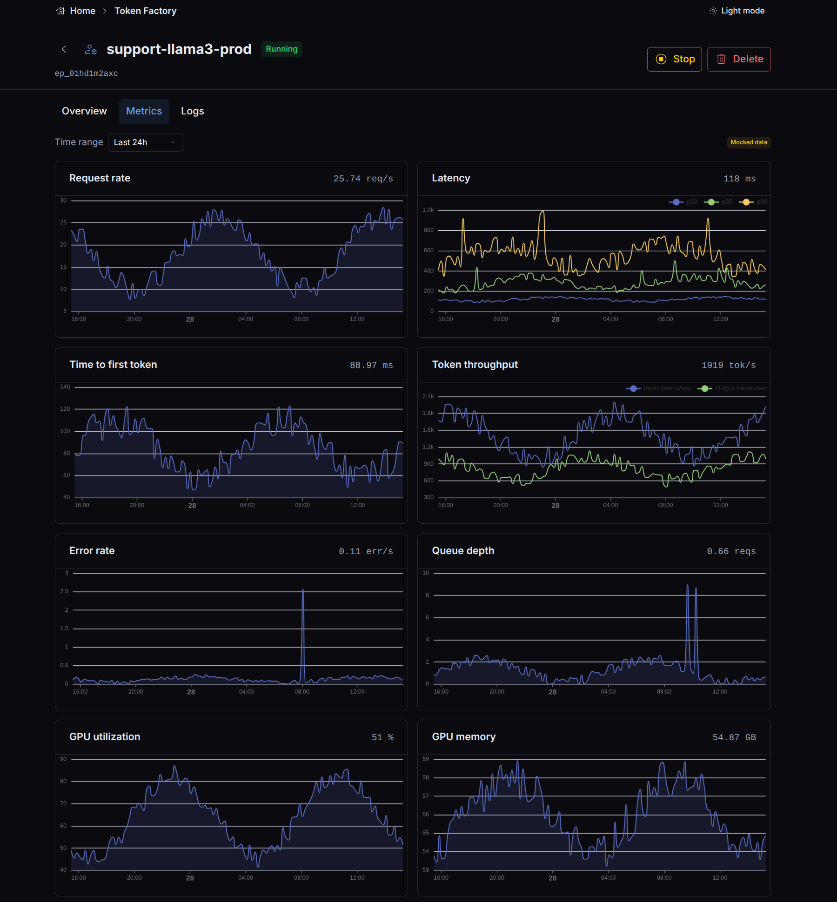
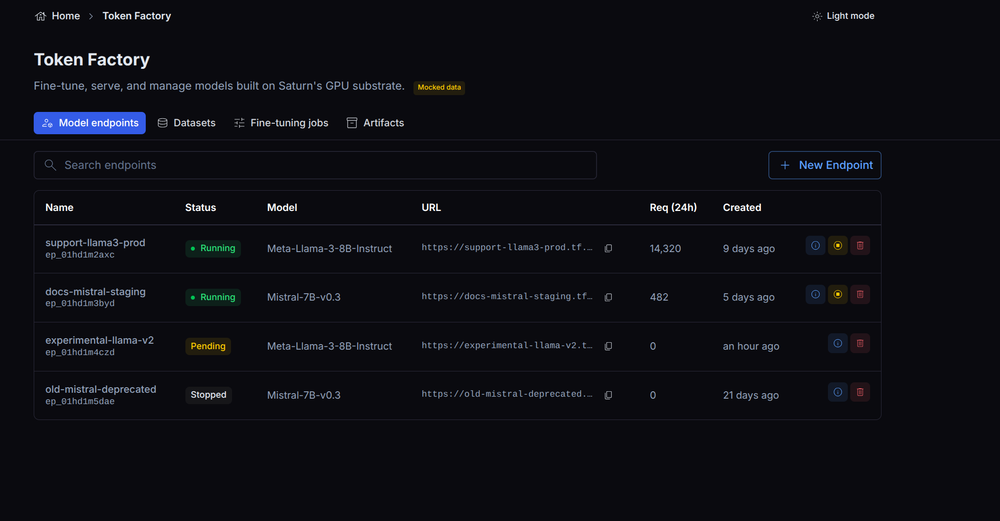

# Inference Endpoints|
| Cluster | Where the endpoint runs, when your organization has more than one cluster. |
| Instance size | The GPU instance each worker runs on. |
| Tensor parallel | How many GPUs one copy of the model is split across. Above one instance's GPUs, each copy spans several nodes. |
| Min workers / Max workers | The autoscaler keeps at least the minimum running and adds workers under load up to the maximum. Setting them equal gives a fixed size. |
| Max GPUs | For disaggregated endpoints, the most GPUs both pools may use together. |
| [Quantization](https://saturncloud.io/glossary/quantization) | Serve the weights at lower precision to use less GPU memory. |

If the model has been profiled, the form starts from the profiled topology and warns you when the hardware you picked has fewer GPUs than profiling used.

## Using an endpoint

Once the endpoint is healthy, send requests to its URL. The endpoint exposes a health check so
the platform (and you) can tell when it is ready to serve. The model stays loaded for the life
of the endpoint, so there is no per-request cold start once it is running.

The endpoint detail page shows its connection details, serving configuration, recent activity,
and an example request.

The **Playground** tab sends chat requests to the endpoint from the browser. A Metrics tab tracks request rate, latency, [time to first token](https://saturncloud.io/glossary/time-to-first-token), token throughput, and GPU use
over time.

## Managing endpoints

Token Factory lists your endpoints with their status, and lets you stop and remove an endpoint
when you no longer need it.

## Lifecycle and the checkpoint

An endpoint holds a read-only reference to its checkpoint for as long as it runs. A checkpoint
that an endpoint is actively serving cannot have its underlying bytes reclaimed: deletion of a
checkpoint with active consumers is blocked, and byte reclamation only happens once every
endpoint that read it has stopped. This means you can delete a checkpoint record without
disrupting an endpoint that is still serving it; the cleanup waits for the endpoint to go away.

## Cost

A dedicated endpoint consumes its GPUs for as long as it runs, whether or not it is receiving
traffic. Stop endpoints you are not using. For
workloads that do not need a model resident at all times, a [fine-tuning job](<docs/inference/fine-tuning.md>) or a batch [Job](/docs) may fit better.
